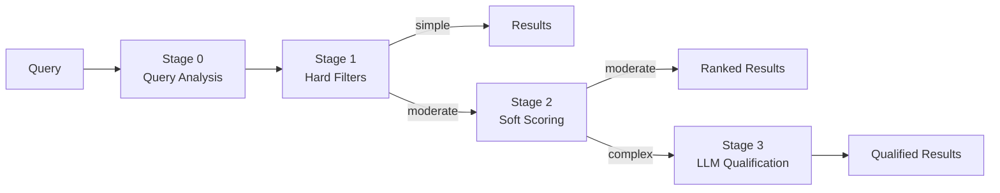

# Company Qualification & Ranking Pipeline

A multi-stage NLP pipeline that takes natural language queries about companies and returns ranked, qualified matches from a dataset of 477 companies.

> *"Logistics companies in Romania with over 50 employees"*

> *"B2B SaaS companies providing HR solutions in Europe"*

> *"Companies that could supply packaging for a D2C cosmetics brand"*

The system decomposes each query into structured filters and semantic signals, then progressively narrows results — from fast deterministic checks to LLM-powered reasoning — using only the depth each query actually needs.

<table>
    <tr>
        <td></td>
        <td></td>
    </tr>
</table>

---

## Architecture



| Stage | What it does | Cost | Latency |
|-------|-------------|------|---------|
| **0** | LLM extracts structured JSON → regex/taxonomy validate | ~$0.0004 | ~200ms |
| **1** | Location, revenue, employees, NAICS field checks | free | <1ms |
| **2** | BM25 + semantic embeddings + RRF fusion (5 signals) | free | ~30ms |
| **3** | LLM batch reasoning on top-K candidates | ~$0.005 | ~2s |

A complexity router decides how deep each query goes. Most queries stop at Stage 1 or 2.

See [WRITEUP.md](WRITEUP.md) for the full reasoning, tradeoffs, error analysis, and scaling roadmap.

---

## Setup

### Prerequisites

- **Python 3.10+**
- **OpenAI API key** — optional for the 12 pre-cached example queries, required for custom queries ([get one here](https://platform.openai.com/api-keys))

### Option A: Run locally

#### 1. Clone and install

```bash
git clone <repo-url>
cd <repo-name>
pip install -r requirements.txt
```

First run will download the `all-MiniLM-L6-v2` embedding model (~90MB, cached after first download). This takes ~30 seconds once.

#### 2. Configure API key (optional for demo)

```bash
cp .env.example .env
```

Edit `.env` and add your key:

```text
OPENAI_API_KEY=sk-your-key-here
```

#### 3. Run the web UI

```bash
python app.py
```

Open **http://localhost:8000** in your browser.

#### 4. Run the CLI

```bash
# Single query
python solution.py --data data/companies.jsonl --query "Pharmaceutical companies in Switzerland"

# All 12 example queries → results.json
python solution.py --data data/companies.jsonl --queries queries.json --output results.json
```

---

### Option B: Run with Docker

```bash
# 1. (Optional) Add your API key
cp .env.example .env
# Edit .env → add OPENAI_API_KEY

# 2. Build and run
docker compose up --build

# 3. Open http://localhost:8000
```

First build takes ~3-5 minutes (downloads Python packages + embedding model). Subsequent builds are fast (~10s) thanks to layer caching.

To stop: `docker compose down`

---

## Usage

### Web UI

The web interface has two panels:

- **Left panel — Pipeline log:** shows the compiled query, Stage 0 extraction, pipeline trace, active filters, scoring signals
- **Right panel — Results:** ranked companies with scores, stage reached, and click-to-expand details (description, offerings, LLM reasoning)

**Try these queries to see different pipeline depths:**

| Query | Complexity | Stages used |
|-------|-----------|-------------|
| "Pharmaceutical companies in Switzerland" | simple | 0 -> 1 |
| "B2B SaaS companies providing HR solutions in Europe" | moderate | 0 -> 1 -> 2 |
| "Companies that could supply packaging for a D2C cosmetics brand" | complex | 0 -> 1 -> 2 -> 3 |
| "Construction companies in the US with revenue over $50 million" | simple | 0 -> 1 |
| "Clean energy startups founded after 2018" | moderate | 0 -> 1 -> 2 |
| "...outside of China" (add to any query) | - | tests negation detection |

### CLI

```bash
# Basic usage
python solution.py --data data/companies.jsonl --query "your query here"

# Batch processing (all example queries)
python solution.py --data data/companies.jsonl --queries queries.json

# Custom output path
python solution.py --data data/companies.jsonl --queries queries.json --output my_results.json

# Change top-K candidates for Stage 2->3
python solution.py --data data/companies.jsonl --query "..." --top-k 50

# Use a different LLM model
python solution.py --data data/companies.jsonl --query "..." --model gpt-4o
```

### Output format

`results.json` contains an array of query results:

```json
{
  "query": "Pharmaceutical companies in Switzerland",
  "total_qualified": 8,
  "companies": [
    {
      "name": "Company Name",
      "score": 0.95,
      "stage": "hard_filter",
      "qualified": true,
      "reasoning": null,
      "website": "example.com",
      "address": "Zurich, Zurich, ch",
      "description": "..."
    }
  ]
}
```

---

## Troubleshooting

| Problem | Fix |
|---------|-----|
| `OPENAI_API_KEY not set` warning | Normal in demo mode. Add key to `.env` for custom queries |
| Slow first startup (~30s) | Embedding model downloading. Cached after first run |
| Port 8000 in use | `docker compose down` or use `python app.py --port 8080` |
| `ModuleNotFoundError: code` | Run from project root, not from inside `code/` |
| Docker build fails | Check internet connection (needs PyPI + HuggingFace) |
| `RuntimeError: LLM extraction failed` | Check API key is valid and has credits |

---

### **Built for the Veridion Engineering Challenge**
