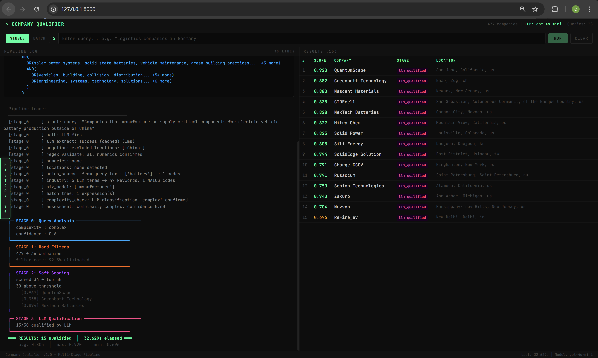
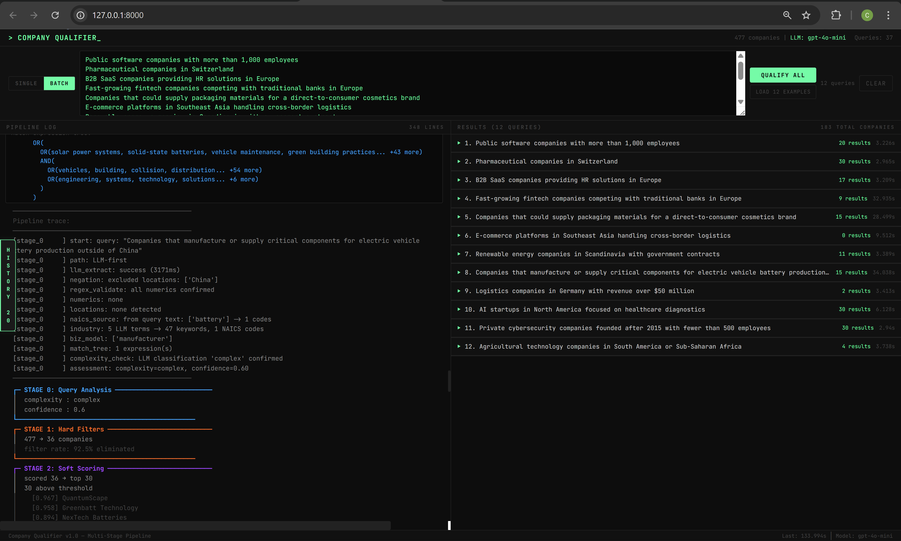
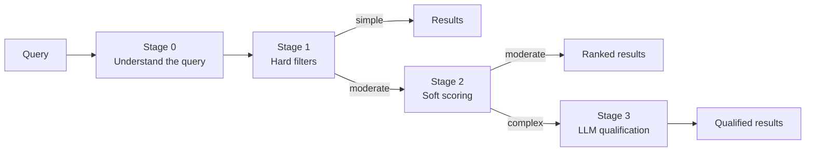

# Intent Qualification

**Natural-language company search that understands what you actually mean.** Ask for "Logistics companies in Romania with over 50 employees" or "Companies that could supply packaging for a D2C cosmetics brand", and get back a ranked list of matching companies with a reason for each match.

Built for the **Veridion Engineering Challenge**: given a dataset of 477 companies and a free-text query, return the companies that truly qualify.

<table>
    <tr>
        <td></td>
        <td></td>
    </tr>
</table>

## The idea

Embedding similarity finds companies that *sound like* the query, which is not the same as companies that *qualify*. And company data is often incomplete, so a missing field shouldn't count against a match.

So the system first turns the query into structured requirements (location, size, industry, business model), then narrows the dataset in stages, from cheap deterministic checks to LLM reasoning, and only goes as deep as each query needs.



| Stage | What it does | Cost | Latency |
|---|---|---|---|
| **0. Query analysis** | An LLM extracts structured JSON; regex and taxonomy validate and normalize it (countries, NAICS industry codes, negations like "outside of China") | ~$0.0004 | ~200 ms |
| **1. Hard filters** | Location, revenue, employee count, founding year, industry code. Companies missing a field pass through rather than being dropped | free | <1 ms |
| **2. Soft scoring** | BM25 keywords + semantic embeddings + keyword match trees + NAICS similarity + business model, combined with Reciprocal Rank Fusion | free | ~30 ms |
| **3. LLM qualification** | Batched reasoning over the top candidates, with an explanation per company. Falls back to Stage 2 scores if the LLM fails | ~$0.005 | ~2 s |

A complexity router decides how far each query goes, so most queries never reach the LLM stages.

The full reasoning, trade-offs, error analysis, and scaling roadmap are in [WRITEUP.md](WRITEUP.md).

## Highlights

- **Query-first design**: structured understanding of the query once, then cheap evaluation per company.
- **Robust to missing data**: a missing field skips that filter instead of rejecting the company.
- **Cost-aware routing**: deterministic checks first, LLM only for queries that need reasoning.
- **Fine-tuning path**: `code/finetune.py` and a Colab notebook fine-tune a small local model (Qwen2.5-1.5B with QLoRA) to replace the Stage 0 API call at scale.
- **Tested per stage**: `tests/` has one test module for each of the four stages.
- **Web UI and CLI**: the UI shows the pipeline trace (what was extracted, which filters fired, which signals scored) next to the results.

## Run it

You need Python 3.10+. An OpenAI API key is optional for the 12 pre-cached example queries and required for custom ones.

```bash
pip install -r requirements.txt
cp .env.example .env        # add OPENAI_API_KEY for custom queries
python app.py               # web UI at http://localhost:8000
```

Or with Docker:

```bash
docker compose up --build
```

The first run downloads the `all-MiniLM-L6-v2` embedding model (~90 MB).

### Command line

```bash
# One query
python solution.py --data data/companies.jsonl --query "Pharmaceutical companies in Switzerland"

# All example queries, written to results.json
python solution.py --data data/companies.jsonl --queries data/queries.json --output results.json
```

### Example queries

| Query | Complexity | Stages used |
|---|---|---|
| "Pharmaceutical companies in Switzerland" | simple | 0 → 1 |
| "B2B SaaS companies providing HR solutions in Europe" | moderate | 0 → 1 → 2 |
| "Companies that could supply packaging for a D2C cosmetics brand" | complex | 0 → 1 → 2 → 3 |
| "Clean energy startups founded after 2018" | moderate | 0 → 1 → 2 |

### Output

```json
{
  "query": "Pharmaceutical companies in Switzerland",
  "total_qualified": 8,
  "companies": [
    {
      "name": "Company Name",
      "score": 0.95,
      "stage": "hard_filter",
      "qualified": true,
      "reasoning": null,
      "website": "example.com",
      "address": "Zurich, Zurich, ch"
    }
  ]
}
```

## Troubleshooting

| Problem | Fix |
|---|---|
| `OPENAI_API_KEY not set` warning | Expected in demo mode. Add a key to `.env` for custom queries |
| Slow first start | The embedding model is downloading; it is cached afterwards |
| Port 8000 in use | `python app.py --port 8080` |
| `ModuleNotFoundError: code` | Run from the project root, not from inside `code/` |
