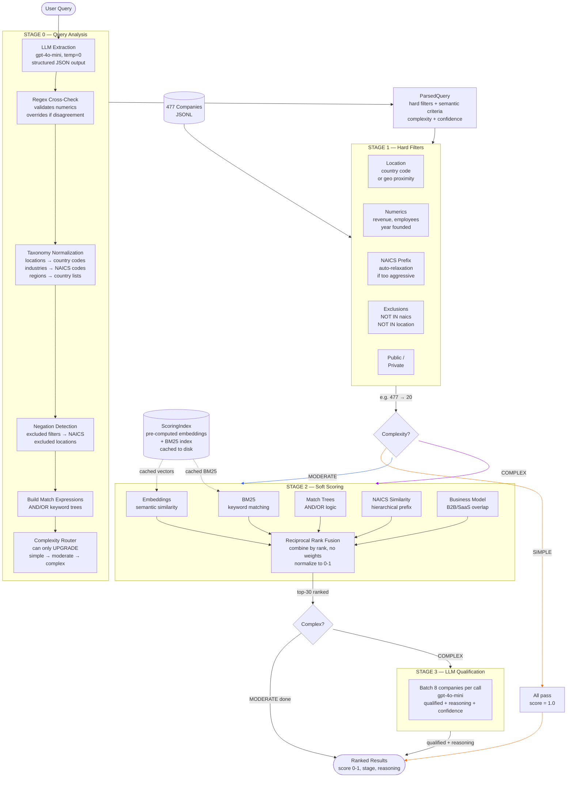
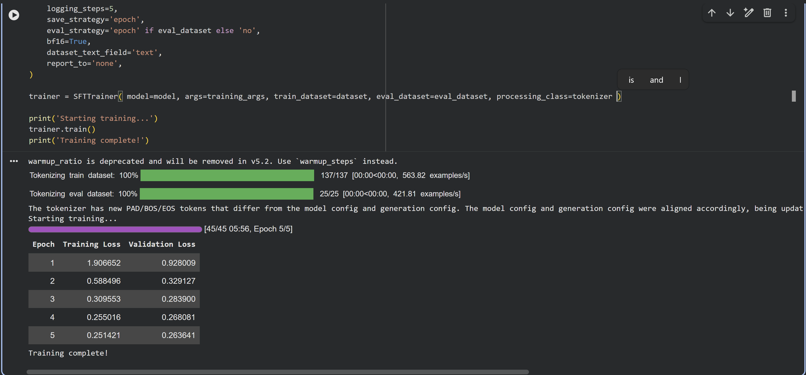
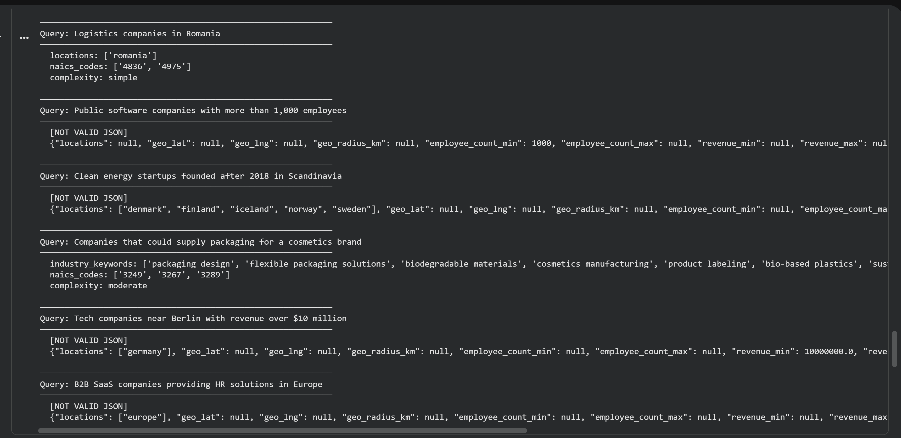
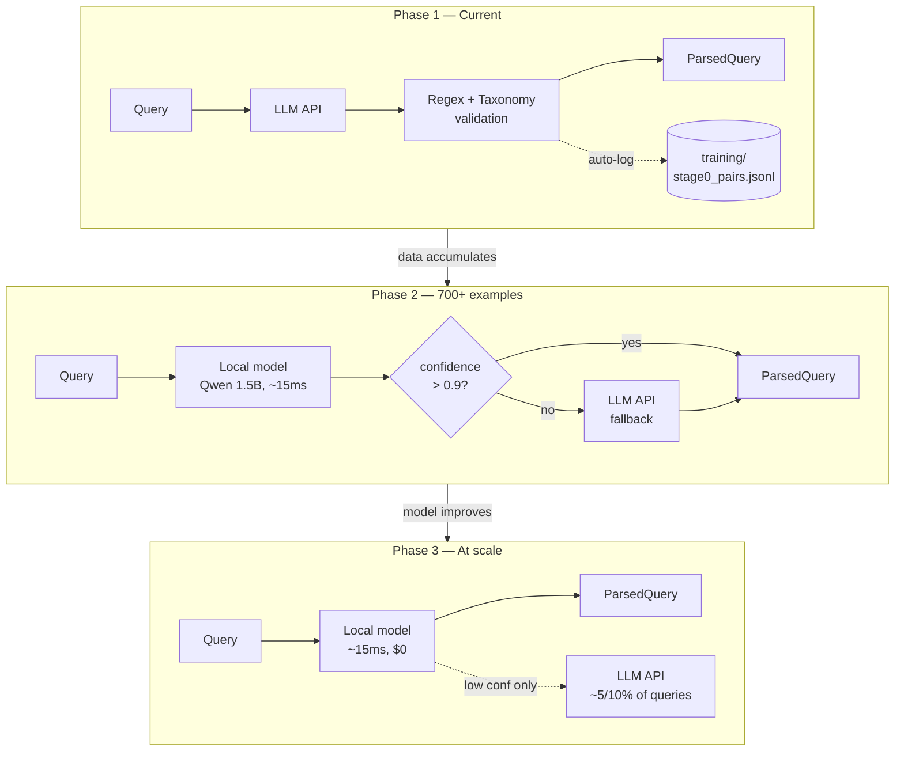
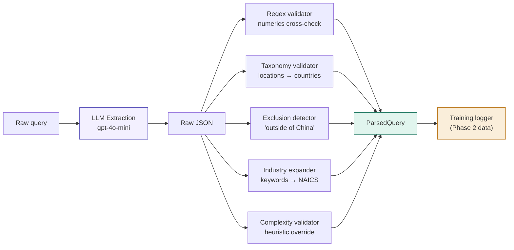
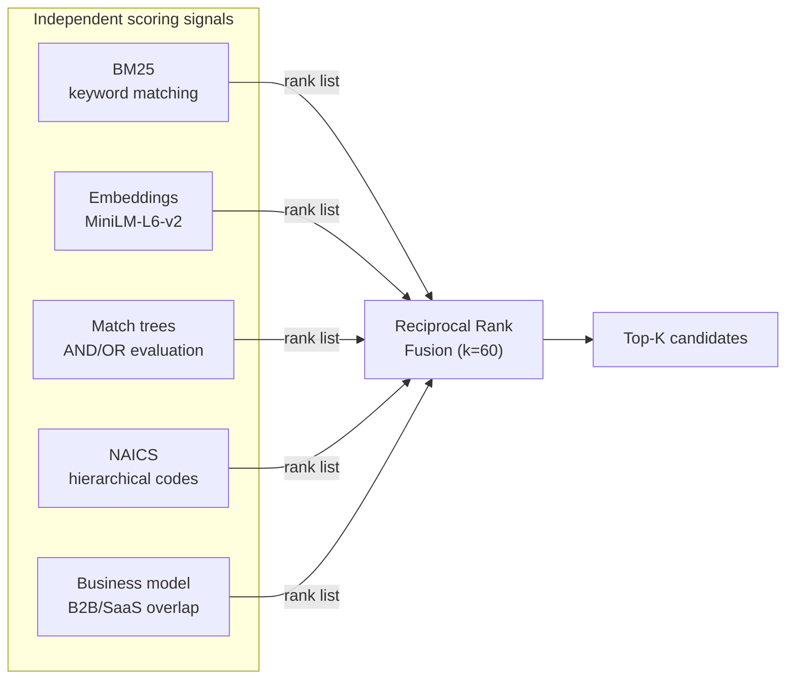
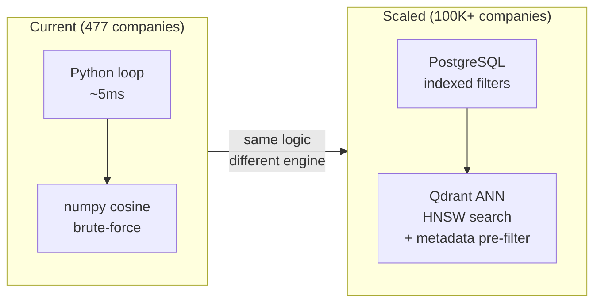
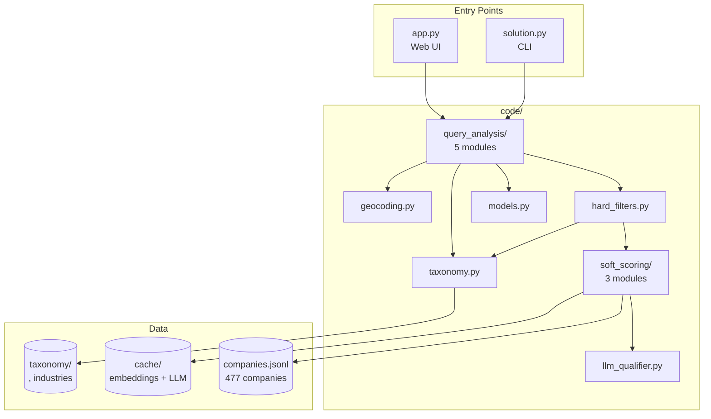

# 1. Approach

## 1.1 Understanding the problem

After reading through the full requirements and studying both baseline strategies - **Baseline A** (LLM per company) and **Baseline B** (embedding similarity) - I noticed that both approaches treat the query as a static input and focus all their effort on the company side. **Baseline A** throws every company at an LLM one by one, which is accurate but expensive and slow, while **Baseline B** embeds everything and ranks by cosine similarity, which is fast and cheap but fundamentally confuses *similarity* with *relevance*.

There's another problem that requirements explicitly warn about: **not every company contains every field**. Missing data is a common thing in a real-world scenario, and can be particularly damaging for embedding similarity. When we embed a company profile with sparse fields, the resulting vector is dominated by whatever data is present, making the similarity score unreliable. For example, a company missing its industry classification might score low against an industry-specific query even if it's a perfect match. Cosine similarity has no way to distinguish between "this company doesn't match" and "we don't have enough data to tell".

This led me to a key insight I would say: **before touching a single company, I should deeply understand the query itself and decompose it into a structured, actionable representation.** Instead of comparing raw text against raw text, we can build a structured query (a filter tree with explicit constraints and expanded keywords) that can be evaluated field-by-field against each company. If a field is missing, the system can handle it gracefully: skip that specific filter rather than penalizing the entire match. If we can produce this structured decomposition *once* per query, the rest of the pipeline becomes cheaper, faster, and more robust to incomplete data.

## 1.2 Understanding the data

Before starting writing code, I first tried to understand the data, conducting an Exploratory analysis ( see `data-analysis.ipynb` ). By doing those I discovered 3 things:

* missing data, which is expected in a real-world scenarios

> if a company has no `employee_count` and the query asks for ">1,000 employees", the company passes the hard filter and gets evaluated semantically in Stage 2. I think it's better to let a few extra companies through to scoring than to silently eliminate good matches because of incomplete profiles. This directly addresses the weakness I identified in Baseline B.

* some format inconsistency that looks like missing data

> for `address` and `primary_naics` we have a batch of 64 entries that have a string representations (`"{'country_code': 'ro', ...}"` instead of `{"country_code": "ro", ...}`). By doing isinstance(val, dict), we would get that those values are missing, which is false. -> to fix this we need a proper way of handling.

```python
parsed = ast.literal_eval(raw) # handles both string and dict 
if isinstance(parsed, dict): 
    return parsed
```

* `address` handling is minimal

> I noticed that `adress` has 13 sub-fields, but from my perspective only 4 are actual useful in our case, due to the small amount of data, and we cannot get that into detail when it comes to finding companies. But either way, if I were to do with this, I would need some extra fields to de added. The current pipeline extracts `country_code` (for location filters), `latitude/longitude` (for geo-proximity), `region_name` and `town` (for fallback string matching) - and ignores the rest. Adding postal code parsing or street-level matching would add complexity for near-zero coverage benefit.

## 1.3 Two families of queries

Looking at the 12 example queries, I identified two distinct families:

**Structured queries** map almost directly to database filters. "Public software companies with more than 1,000 employees" gives us three concrete constraints: `is_public = true`, `primary_naics ∈ software codes`, `employee_count > 1000`. No ambiguity, no interpretation needed -3 the query *is* the filter.

**Reasoning-heavy queries** require interpretation and inference. "Companies that could supply packaging materials for a direct-to-consumer cosmetics brand" doesn't name a specific industry - it implies a supply chain relationship. "Fast-growing fintech companies competing with traditional banks in Europe" requires understanding what "fast-growing" means (revenue trend? employee growth? founding year?) and what "competing with traditional banks" implies about the company's products.

Most queries fall somewhere on the spectrum between these two extremes. The system needs to handle both ends gracefully.

## 1.4 Pipeline architecture



Based on this, I designed a sequential multi-stage pipeline where each stage progressively narrows down the results - going from broad and cheap to precise and expensive. The idea is simple: don't run expensive operations on every company. Filter aggressively first with fast deterministic checks, and only bring in the heavy stuff for the candidates that survived.

The pipeline has four stages:

**Stage 0 -> Query Analysis** - here we are gonna parse the raw query into a structured representation: hard filters, semantic keywords, NAICS codes, complexity level. This is the foundation - everything downstream depends on it getting this right

**Stage 1 -> Hard Filters** - we have a direct field-level comparisons against the structured output from Stage 0. Does the company's country match? Is the employee count within range? Do the NAICS codes align? Binary pass/fail, zero cost, runs in milliseconds

**Stage 2 -> Soft Scoring** - for the companies that passed the hard filters, we compute a relevance score using BM25 keyword matching, semantic embedding similarity, and Reciprocal Rank Fusion (RRF) to combine both rankings. Additionally, match expression trees (AND/OR keyword combinations), NAICS hierarchical similarity, and business model alignment are used   as scoring signals. Returns a ranked top-K.

**Stage 3 -> LLM Qualification** - It's only for complex queries that need actual reasoning. Takes the top-K from Stage 2, batches them, and asks an LLM to qualify each one against the original query. Graceful degradation: if the LLM fails, we fall back to Stage 2 scores.

A **complexity router** in Stage 0 decides how deep we go:

- **Simple** queries (only hard filters) -> Stage 0 + 1 only
- **Moderate** queries (filters + semantics) -> Stage 0 + 1 + 2
- **Complex** queries (needs reasoning) -> Stage 0 + 1 + 2 + 3

This means the vast majority of queries never touch the LLM, which keeps costs low and latency predictable.

---

## 2. Stage 0 --- Query analysis

Stage 0 is the most important part of the pipeline because every downstream decision depends on it. If Stage 0 misparses the query, the rest of the pipeline is working with wrong information. So I spent the most time thinking about how to do this right.

The output of Stage 0 is always the same (it contains: hard filters, semantic criteria, match expressions, complexity, and confidence). What matters is *how* we produce that output.

I evaluated three approaches for the core extraction logic:

### 2.1 Option A --- Regex + taxonomy (deterministic)

Use regex patterns to extract numeric constraints (employees, revenue, year founded), taxonomy dictionaries to resolve locations and industry terms, and heuristic rules for everything else.

| # | Pros | Cons |
|---|------|------|
| 1 | Zero cost, zero latency, zero external dependencies | Can't capture all user formulations |
| 2 | Fully deterministic - same input always produces the same output | Lower accuracy on ambiguous or informal queries |
| 3 | Easy to unit test - each regex and rule is independently verifiable | Each new edge case means another regex rule added manually, and the complexity grows fast |
| 4 | Works offline, no internet, no GPU needed | Zero reasoning ability |

### 2.2 Option B --- LLM API (gpt-4o-mini / Claude Haiku)

Send the raw query to an LLM with a structured prompt, and get back a JSON with all extracted fields.

| # | Pros | Cons |
|---|------|------|
| 1 | Almost perfect accuracy out of the box, understands intent and nuance without explicit rules | Cost scales linearly with volume (the cost for 100K queries/day can be high) |
| 2 | Minimal setup - write a good prompt and you're done | External dependency - if OpenAI/Anthropic goes down, the pipeline stops & also we can have rate limiting at peak traffic |
| 3 | Can do actual reasoning - understands supply chains, indirect relationships | Non-deterministic - even with temperature=0, outputs can vary slightly between calls |
| 4 | Easy to iterate - change the prompt, not the code | Variable latency |

### 2.3 Option C --- Fine-tuned local model (LoRA)

For my data I can take a small pre-trained model (Qwen2.5-3B or Phi-3.5-mini), fine-tune it on query -> JSON pairs and run it locally.

| # | Pros | Cons |
|---|------|------|
| 1 | Zero runtime cost, constant low latency | More time needed for setup |
| 2 | Full control of the model | Requires ML expertise |
| 3 | Accuracy improves over time with more training data | Periodic re-training when new industries or query patterns appear |
| 4 | Deterministic with fixed seed - reproducible outputs | A 3B model has a reasoning ceiling - won't match GPT-4o on very complex queries |

### 2.4 Decision: progressive implementation

None of these is clearly the best in every scenario. But they chain together naturally, and each phase generates what the next phase needs.

**Phase 1 (current):** I'm using an LLM API call as the primary extractor, then use regex + taxonomy as validators that normalize the output (if needed). If the LLM says `revenue_min:50000` but the regex parses "$50 milion as 50,000,000 - regex will win.  Locations get normalized through the country alias dictionary, industry terms get mapped to NAICS codes. Cost is negligible at our current volume.

**Phase 2 (as data accumulates):** Every `(query -> validated output)` pair gets logged as free training data. At 500-700+ examples, fine-tune a local model. Switch when local model hits 90%+ agreement ( see `finetune_local_model.ipynb` )




**Phase 3 (when scale demands it):** Local model will be primary, LLM API as fallback only for low-confidence queries. Zero cost on ~80/90% of queries, maximum accuracy on the rest.



#### Why did I choose API calls as a first?

When I first started thinking about whether to build a local model or use an API, I looked at the company infrastructure - 130M+ companies, 100M+ predictinos per day, 25+ custom LLMs running on dedicated GPU clusters. The scale of the operation makes a fine-tuned local model the obvious end goal. But in order to get there you need `good training data`, and `good training data requires diversity`

If I were to generate training pairs synthetically with AI, the data would reflect how an LLM formulates queries - not how real users do. The whole point of my query parser is handling the messy, unpredictable way people search. 

> *That's why by using the API in Phase 1, every real query becomees naturally diverse training example. The LLM parses it, the regex and taxonomy validators cross-check and correct it, and the validated pair gets logged automatically. After a few hundred real queries, the training set naturally covers edge cases, typos, regional phrasing, and domain-specific jargon that no synthetic dataset would include. That's when the local model can be trained on data that actually represents production traffic.*

I ran a proof-of-concept fine-tuning on Google Colab using Qwen2.5-1.5B-Instruct with QLoRA on 162 logged pairs. The model learned the JSON schema correctly and handled simple queries well (locations, NAICS codes, complexity classification - partialy). On complex queries the output was sometimes truncated - expected at this scale, and exactly what more training data would fix.



### What I tried and abandoned

I initially tried **spaCy NER** for extracting locations and industry names from queries. It didn't work well - spaCy would misclassify brand names as locations ("Shopify" flagged as GPE), miss region names like "Scandinavia" entirely, and return inconsistent results across similar queries.

---

## 3. Stage 1 --- Hard filters

Once Stage 0 produces the structured query, Stage 1 does fast elimination. It checks every company against hard constraints - location, employee count, revenue, year founded, public/private status, NAICS codes.

Key design decisions:

> **Missing data tolerance** - if a company doesn't have a `revenue` field, it passes the revenue filter by default. We don't penalize incomplete data. This directly addresses the problem I identified with Baseline B, where missing fields silently tank the similarity score.

> **NAICS relaxation** - if the NAICS filter eliminates too aggressively (fewer than ~1% of companies pass), we automatically drop it from Stage 1 and push it to Stage 2 as a soft scoring signal instead of a hard gate.

> **Geo-proximity** - queries like "near Munich" or "within 50km of London" use Haversine distance computation against a built-in city coordinate dictionary. Companies without coordinates are rejected for proximity queries (unlike country-level filters where missing data = pass), because "near London" requires knowing *where* the company is.

> **Negation** - "companies in Europe excluding Germany" correctly expands Europe to all countries, then removes Germany from the list. Exclusion filters are *never* relaxed, even when NAICS filters are.

> **Performance** - at 477 companies, the full filter pass runs almost instantly. I deliberately chose not to add pandas or SQLite because the Python loop is already fast enough at this scale. At 100K+ companies, this stage would merge into a vector DB metadata filter - but premature optimization at 477 would just add complexity for zero gain.

---

## 4. Stage 2 --- Soft scoring

### Version 1: TF-IDF with fixed weights (abandoned)

My first implementation used TF-IDF cosine similarity with manually assigned weigths: 35% TF-IDF, 30% match expressions, 20% NAICS similarity, 15% business model. But this had three problems:
> **TF_IDF is a bag-of-words** -> "shipping" and "freight" score as zero similarity even though they're synonyms

> **No document length normalization** -> long descriptions get free points simply because they contain more words.

> **The weights were arbitrary** -> what are the reasons of my selection?

### Version 2: BM25 + Semantic Embeddings + Reciprocal Rank Fusion ( current )

I replaced the weighted sum with a fundamentally different approach. Five independent signals, each producing a ranked list, fused with RRF:



> **Why RRF instead of weighted sum:** A weighted sum requires normalizing scores to the same scale (`BM25 returns 0-25, embeddings return 0-1` - how do you normalize? min-max? z-score? each choice is arbitrary) and tuning weights (0.30 vs 0.35 - on what basis?). **RRF** operates on **ranks**, not scores. Ranks are already normalized (1, 2, 3...). A company that ranks highly across multiple signals naturally bubbles to the top. This approach comes from Cormack, Clarke & Buettcher (2009) who showed RRF outperforms individual systems and standard metasearch methods.

> **Why BM25 over TF-IDF:** BM25 includes term saturation (a keyword appearing 50 times doesn't score 50x higher than appearing once) and document length normalization. These are exactly the problems I had with TF-IDF.

> **Why semantic embeddings:** `all-MiniLM-L6-v2` understands that "shipping" ≈ "freight" ≈ "cargo transport". This covers the synonym gap that BM25 can't solve.

> **Pre-computed ScoringIndex:** Company embeddings are encoded once at startup and cached to disk. Per-query cost is ~5ms (encode query only + numpy cosine on cached matrix) instead of ~500ms (re-encode all companies). The disk cache uses a SHA-256 hash of all company texts - if the data changes, embeddings are automatically rebuilt.

---

## 5. Stage 3 --- LLM batch qualification

Only triggered for complex queries - the ones where keyword matching isn't enough and we need actual reasoning about supply chains, competitive dynamics, or indirect relationships.

> **Batching:** groups the top-K candidates into batches of 8 and sends each batch to gpt-4o-mini. For 30 candidates, that's 4 API calls instead of 30.

> **Graceful degradation:** if any LLM call fails (timeout, rate limit, 500 error), we fall back to Stage 2 soft scores for those companies. The pipeline never hard-fails because of an LLM issue.

> **Score blending:** final score = 30% soft score + 70% LLM confidence. This ensures that a company ranked #1 by keyword matching but deemed "not relevant" by the LLM gets properly downranked, while a company that the LLM qualifies highly gets boosted even if it wasn't the top keyword match.

> **Constant at scale:** Stage 3 processes only the top-K candidates regardless of how many companies are in the dataset. At 477 or 10 million companies, Stage 3 makes the same 4 API calls.

---

## 6. Tradeoffs

Every design decision in this pipeline sacrificed something to gain something else. Here's what I chose, why, and what I gave up.

### 1. Recall over precision at Stage 1

- **Optimized for:** robustness - not losing good matches
- **Sacrificed:** precision - some irrelevant companies leak through

> `Missing data = pass` means a comapany without `employee_count` passes an "under 1,000 employees" filter. With 39% of the dataset missing employee data, the alternative (`missing = fail`) would silently drop nearly half the companies on any employee query. I chose to let false positives through to Stage 2 rather than risk *false negatives* at Stage 1. Stage 2 then ranks them - irrelevant companies sink to the bottom of the scored list, they just don't get hard-rejected.

> The same logic I applied to NAICS relaxation: when the industry filter eliminates too aggressively, it's demoted to a soft signal rather than being a hard gate. This means Stage 2 sometimes scores companies outside the target industry - but it's better than returning 3 results when there are 20 good matches hiding behind a too-narrow NAICS prefix.

### 2. LLM API over local model for Stage 0

- **Optimized for:** accuracy + development speed
- **Sacrificed:** cost + external dependency + determinism

> Using gpt-4o-mini for Stage 0 extraction costs ~$0.0004 per query ( for 500 requests I consumed $0.20). The accuracy gain over pure regex is significant - the LLM correctly handles "companies competing with traditional banks" (complex reasoning) while regex would need manual rules for every such pattern. The Phase 2 fine-tuning path eliminates this cost when volume justifies it.

> **! *But right now, no API key = no custom queries. That's a real limitation I chose to accept because the accuracy gain was more important than offline capability for a 477-company demo***

### 3. BM25 + embeddings over a single scoring method

- **Optimized for:** accuracy (covering both keyword matches and semantic similarity)
- **Sacrificed:** simplicity + startup time

> `BM25 alone` misses synonyms ("shipping" != "freight"). `Embeddings alone` miss exact keyword matches when the company description uses different phrasing. Combining them through `RRF covers both failure modes` - but it means two pre-computed indexes at startup (BM25 corpus + embedding matrix), two dependencies (rank-bm25 + sentence-transformers), and a ~30/40 second cold start for the embedding model download.

> At 477 companies, a single TF-IDF pass would be simpler and ~15ms faster. I chose the more complex approach because the accuracy difference was visible on test queries - "clean energy" queries were missing companies that said "renewable power" (synonym gap that only embeddings solve)

### 4. Batch LLM qualification over per-company calls at Stage 3

- **Optimized for:** cost + latency
- **Sacrificed:** qualification granularity

> Sending 8 companies in one LLM prompt is cheaper and faster than individual calls. But the LLM has less attention budget per company (`in a batch of 8`), a subtle distinction between two similar companies might get missed. Individual calls would give each company the LLM's full context window.

### 5. Pre-computed embeddings over on-the-fly encoding

- **Optimized for:** query latency (~5ms vs ~500ms per query)
- **Sacrificed:** freshness (outdated if data changes) + disk space

>At startup, all 477 company texts are encoded into a (477, 384) embedding matrix and cached to disk with a SHA-256 hash of the input. On subsequent starts, the cache loads instead of re-encoding (which takes a lot more time). At query time, only the query gets encoded, then a numpy cosine similarity against the cached matrix gives us 477 similarity scores.

>The cache invalidates automatically: if the data changes, the hash changes, and embeddings are rebuilt. For a static dataset of 477 companies this is enough.

**What breaks at scale?**

> My approach has 2 assumptions that couldn't hold at scale: <u>the full matrix fits in RAM</u> and <u>brute-force cosine is fast enough</u>. Assuming that your data is live-updating, the current approach works only for batch updates but not for real-time. I would move to a dedicated vector database, Qdrant let's say, that supports upserts (add/update individual vectors). That would allow me to re-encode the changed company when its profile is updated, and to be sure, periodically rebuild the full index to prevent drift from incremental updates.

### 6. Taxonomy-based NER over spaCy

- **Optimized for:** precision (zero false positives)
- **Sacrificed:** generalization to unseen entity names

> spaCy NER would generalize to locations and industries it's never seen. My taxonomy approach only matches terms that exist in the dictionaries. But spaCy had real problems on this data: it flagged brand names as locations, missed region names like "Scandinavia", and was inconsistent across similar queries. The taxonomy gave zero false positives at the cost of requiring manual dictionary maintenance for new terms.

**What I'd do differently:**

> The taxonomy works at 477 companies, but two assumptions break with real-world usage: <u>`all queries are in English`, and `all industry terms exist in the dictionary`</u>

> **Multilingual queries.** A user searching `"entreprises en France"` or `"Companii care se ocupa de productia mezeluri"` gets nothing from an English-only taxonomy. The current LLM-based Stage 0 could handle this - gpt-4o-mini understands any language and returns standardized English JSON. For the Phase 2 local model, Qwen 1.5B is multilingual natively, so fine-tuning on mixed-language training data would preserve this capability.

> **At scale, the taxonomy disappears entirely**. Instead of mapping query terms to NAICS codes and then matching those codes against companies, I'm going to skip the intermediary - encode the query, vector-search directly against company embeddings, and let semantic similarity do the matching. Industry classification becomes a soft scoring signal, not a hard lookup gate. The taxonomy served its purpose as a bootstrap mechanism for structured matching at small scale; at large scale, learned representations replace it.

### Summary

| Decision | Optimized for | Sacrificed |
|----------|--------------|------------|
| Missing data = pass | Robustness (recall) | Precision (false positives leak through) |
| LLM API for Stage 0 | Accuracy + dev speed | Cost + offline capability |
| BM25 + embeddings dual | Accuracy (keywords + synonyms) | Simplicity + startup time |
| Batch LLM (8 per call) | Cost + latency | Per-company attention granularity |
| Pre-computed embeddings | Query latency (5ms vs 500ms) | Freshness if data changes |
| Taxonomy over spaCy | Precision (zero false positives) | Generalization to unknown terms |

> The general pattern: I optimized for **robustness and accuracy** at the cost of **simplicity and offline capability**

---

## 7. Error analysis

I did 22 stress-test queries across 6 categories, all results from the live pipeline. For each query: what was expected, what happened, and the verdict.

### Group 1 -> Edge cases: numeric parsing

| Query | Extracted | Results | Verdict |
|-------|-----------|---------|---------|
| "Companies with between 100 and 500 employees in Germany" | `emp>=100, emp<=500, location=germany` | 5 companies, all DE, all in range |  Pass |
| "Revenue under €5 million in France" | `rev<=5,000,000, location=france` | 25 companies, all FR, all under €5M | Partial - also extracted NAICS 5415 from the word "revenue" |
| "Private companies founded between 2015 and 2020" | `is_public=false, yr>=2015, yr<=2020` | 190 companies | Partial - also extracted NAICS 5232 from the word "private" |

> **Analysis:** Numeric extraction works perfectly - regex and LLM agree on all values, euro conversion is correct, "between X and Y" maps to min/max. The issue is the taxonomy matching non-industry words: "revenue" matches "revenue cycle management" -> NAICS 5415, "private" matches "private equity" -> NAICS 5232. In both cases NAICS was auto-relaxed so results were unaffected, but it's noise. **Fix:** a stopword list for the taxonomy matcher excluding common non-industry words.

### Group 2 -> Negation and exclusion

| Query | Excluded | Results | Verdict |
|-------|----------|---------|---------|
| "Software companies in Europe but not in the UK" | `excluded: united kingdom` | 8 companies: FR, FI, LU, DE, PT, UA, ES. Zero GB |  Pass |
| "Logistics companies outside of Germany" | `excluded: germany` | 4 companies: RO (×3), RO. Zero DE |  Pass |
| "Manufacturing companies NOT in construction" | `excluded NAICS: 23` | 30 companies, no construction NAICS |  Partial - see below |
| "Companies in Asia excluding China and Japan" | `excluded: china, japan` | 19 companies: IN, SG, VN, TW, ID. Zero CN/JP |  Pass |

> **Analysis:** All exclusion patterns work correctly - "but not", "outside of", "NOT in", "excluding" all produce the right excluded locations/industries. The partial failure on "Manufacturing NOT in construction" is not about negation (construction exclusion works) but about the LLM hallucinating renewable energy keywords for generic "manufacturing." Top results are wind/solar companies instead of diverse manufacturers. **Root cause:** when the query says a broad sector without specifics, the LLM picks a sub-sector for keyword generation.

### Group 3 -> Geo-proximity

| Query | Geocoded | Radius | Results | Verdict |
|-------|----------|--------|---------|---------|
| "Tech companies near Berlin" | 52.52, 13.41 | 50km | 1 company: TerraGreen (Berlin) | Pass (few results = small dataset, not bug) |
| "Companies close to London with more than 100 employees" | 51.51, -0.13 | 50km | 5 companies, all London area | Pass |
| "Startups within 50km of San Francisco" | 37.77, -122.42 | 50km | 14 companies: SF, Palo Alto, Berkeley, Stanford, Newark, Alameda, Redwood City | Pass |

> **Analysis:** Geocoding, radius inference, and haversine distance all work correctly. Berlin has only 1 tech company in the dataset - that's a data limitation, not a pipeline failure. San Francisco shows the best result: 14 companies across 7 Bay Area cities, all within the 50km radius, correctly ranked by "startup" relevance.

### Group 4 -> Graceful degradation

| Query | Expected behavior | Results | Verdict |
|-------|-------------------|---------|---------|
| "Companies" | All 477, low confidence | 477 results, confidence=0.40 | Technically correct but useless |
| "Good companies that are nice" | Low confidence, few/no results | 16 packaging companies | Fail - "good" matched "goods" in taxonomy |
| "Aerospace companies in Nigeria" | 0 results (no aerospace in Nigeria) | 0 results | Pass - graceful empty |
| "Companies that could help a hospital reduce patient wait times" | Complex query, LLM qualification | 7 results: PSI CRO, AliveDx, Lumeros AI, MSD, TCS, Wipro | Pass - reasonable results |
| "Renewable energy companies in Antarctica" | 0 results (no companies in Antarctica) | 0 results | Pass - graceful empty |

> **Analysis:** The pipeline handles impossible queries well - Nigeria and Antarctica return clean zeros, no crash, no garbage. The complex hospital query correctly triggers Stage 3 and returns plausible results (CRO, diagnostics, IT consulting firms that serve healthcare). Two clear problems:

- **"Companies"** returns the entire dataset unranked. Confidence is 0.40 but the pipeline doesn't act on it. Should either warn "query too vague" or auto-upgrade to moderate for ranking.
- **"Good companies that are nice"** returns packaging/plastics companies because "good" matched "goods" -> consumer goods -> plastics manufacturing NAICS codes. A meaningless adjective triggered a specific industry filter.

### Group 5 -> Complex reasoning (supply chain, competition)

| Query | Stage 3 qualified | Top results | Verdict |
|-------|-------------------|-------------|---------|
| "Supply raw materials for semiconductor manufacturing" | 1/10 | BayWa r.e. Scandinavia (renewable energy) | Fail - completely wrong industry |
| "Firms competing with insurance companies using AI" | 2/30 | SkyHarvest (solar), Genpact (IT outsourcing) | Fail - neither competes with insurers |
| "Potential partners for European EV manufacturer" | 9/30 | Greenbatt (batteries), Dacia (auto), CIDEcell (battery R&D), Mercedes-Benz, WBS Mobility | Pass - diverse, relevant partners |

> **Analysis:** The EV manufacturer query is the system's best complex result — it found battery suppliers, auto manufacturers, mobility companies, and industrial portfolio firms across Europe. Stage 3 LLM correctly qualified 9 relevant companies and rejected 21 irrelevant ones.

> The other two fail because the dataset doesn't contain matching companies. For semiconductor materials, NAICS 3344 matched only 10 companies (all electronics/energy), and the LLM "qualified" the least-bad option rather than returning empty. For insurance+AI, NAICS 524 matched 0 > full relaxation -> Stage 2 scored on "AI" keywords -> Stage 3 qualified companies mentioning AI regardless of insurance relevance.

> **Key insight:** when the dataset genuinely doesn't cover the query's domain, the pipeline produces confidently wrong results instead of honest empty results. The LLM qualification step should have a minimum confidence threshold below which it rejects all candidates.

### Group 6 -> Taxonomy gaps (niche industries)

| Query | NAICS matched | Top 3 results | Verdict |
|-------|---------------|---------------|---------|
| "Quantum computing startups" | 3345, 5113, 5112, 5415, 5417 (broad tech) | Booz Allen, Mphasis, Wipro | Fail - large IT consultancies, not quantum |
| "Space debris removal companies" | 3364 -> relaxed -> all | 477 results, all score 1.0 | Fail - entire dataset, unranked |
| "Synthetic biology firms in Europe" | 3254, 6215, 5417 | CRISPR Therapeutics, Novartis, Ferring | Pass - relevant biotech/pharma |
| "Carbon capture technology companies" | 2211, 5416, 2212 + 3 more | Puhuri (wind), Tri Hita Consulting, Kraftkar Energi | Partial - renewable energy, not carbon capture |

> **Analysis:** "Synthetic biology in Europe" is the success - CRISPR Therapeutics at #1 is exactly right, and the Swiss pharma cluster fills out the top 10 with relevant biotech firms.

> "Quantum computing" fails because the NAICS codes are too broad (all software/tech), and no company in the dataset actually does quantum computing. The results are "big tech companies with long descriptions" - BM25 and embeddings rank them highly because more text means more incidental keyword overlap.

> "Space debris removal" is the worst failure: NAICS 3364 (Aerospace) relaxed to all, classified as **simple** (no Stage 2), so the entire dataset returns unranked. This is the "niche industry + simple classification + NAICS relaxation" triple failure. **Fix:** auto-upgrade to moderate when NAICS relaxation triggers.

> "Carbon capture" returns renewable energy companies - related but not the same. The taxonomy maps "carbon" to energy sector NAICS codes, and embeddings match on sustainability keywords. Honest result given the dataset, but misleading.

---

## Failure modes - summary

Six systematic patterns identified from the 22 test queries:

| # | Pattern | Observed in | Impact | Proposed fix |
|---|---------|-------------|--------|--------------|
| 1 | Non-industry words trigger NAICS | "revenue"->5415, "private"->5232, "good"->326x | False filters, usually relaxed away | Taxonomy stopword list |
| 2 | LLM hallucinating sub-industry for generic queries | "Manufacturing NOT construction" -> renewable energy keywords | Results skewed to one sub-sector | Detect broad queries, use wider keyword set |
| 3 | Niche + simple + NAICS relaxed = unranked dump | "Space debris" -> 477 unranked | Entire dataset returned | Auto-upgrade to moderate when NAICS relaxed |
| 4 | No matching data -> forced wrong results | Semiconductor, insurance+AI | Confidently wrong results | Min LLM qualification threshold |
| 5 | Duplicate companies in results | windainergy ×2, CIRKEL Energi ×2 | Wasted result slots | Deduplicate by website after scoring |
| 6 | Broad NAICS for niche industries | "Quantum computing" -> all tech NAICS | IT consultancies rank above startups | Finer-grained NAICS taxonomy or embedding-only scoring for niche |

---

## 8. Scaling - from 477 to 100K+ companies

My current pipeline processes 477 companies in under 200ms (excluding Stage 3 LLM calls). At 100,000 companies per query, three stages will break:

### Stage 1: Hard Filters

> Right now, Stage 1 is a Python loop doing field comparisons - runs in ~5ms at 477 companies. At 100K, I think this is stil acceptable.At 1M+, the loop becomes the bottleneck. The fix is straightforward: to move hard filters into a database with indexed columns. PostgreSQL with indexes on `country_code`, `employee_count`, `revenue`, `year_founded`, `is_public` turns the O(n) loop into indexed lookups. NAICS prefix matching maps to a `LIKE '5112%'` query with a B-tree index. Geo-proximity becomes a PostGIS `ST_DWithin()` call with spatial indexing.

> `The important thing is that the **filter logic stays identical** - the database is just a faster execution engine for the same pass/fail rules.`

### Stage 2: Soft Scoring

This is where the real scaling challenge lives. Currently, BM25 and cosine similarity both run brute-force over all filtered companies.
At 100K, two changes are needed:

- **Replace brute-force cosine with ANN (Approximate Nearest Neighbors).** A vector database like Qdrant provides sub-linear search, instead of computing 100K cosine similarities, ANN returns the top-K approximate matches in ~10ms using HNSW indexing. The tradeoff is approximate vs. exact: ANN might miss a company that ranks #31 when K=30.

- **Pre-filter before vector search.** Qdrant supports metadata filtering (payload filters) natively - combine hard filters + ANN in a single operation. Instead of "filter 100K -> 2000 -> score 2000", it becomes "vector search within the filtered subset" in one call.



### Stage 3: LLM Qualification

> Stage 3 is already scale-independent - it only processes the top-K candidates from Stage 2 (currently 30-40). Whether the dataset has 477 or 10 million companies, Stage 3 makes the same API calls.

### Stage 0: Query Analysis

> Is also scale-independent - one LLM call per query regardless of dataset size. At very high query volume, the Phase 2 fine-tuned local model becomes essential to eliminate API costs and latency. The training data pipeline is already in place.

---

## 9. Code structure overview


